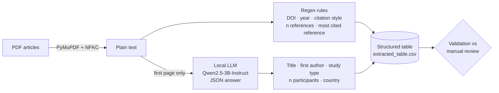
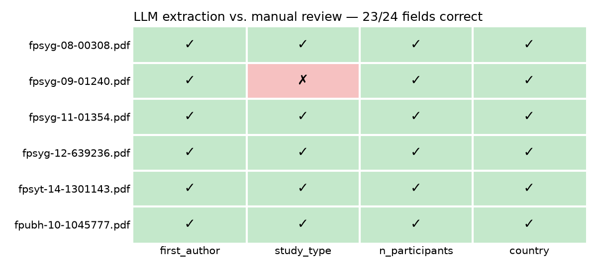

# Structured Data Extraction from Scientific Literature with a Local LLM


-6F42C1)


---

# 🎓 About this Project

This project was developed for the **Data Collection Techniques** course in the **MSc in Big Data Science at the University of Navarra (Spain)**.

The scenario: *a pharmaceutical company wants to develop new drugs and experiments, and needs to review the published research.* The task is to turn a set of scientific articles (PDF) into **one structured table**, where each row is an article and each column a variable of interest, using a **Large Language Model that runs locally**.

---

# 📌 Highlights

- ✅ End-to-end pipeline: **PDF → text → structured dataset (CSV)**
- ✅ **Hybrid extraction:** regular expressions for fixed-format fields, a local LLM for fields that need reading comprehension
- ✅ **Local LLM** (`Qwen2.5-3B-Instruct`, Hugging Face): no document leaves the machine
- ✅ 12 variables per article, with **explicit nulls** when a variable does not apply (never invented)
- ✅ **Validated against a manual review:** 23 / 24 LLM fields correct on the sample
- ✅ Modular, reusable code in [`src/`](src)

---

# 📖 Project Overview



---

# 🎯 Business Problem

In pharmaceutical R&D, systematic literature reviews feed decisions on **new drugs, trial design and target populations**. Reviewers read hundreds of papers and copy the same variables (study design, sample size, country, key references) into spreadsheets, which is slow and error-prone.

**Goal:** automate the extraction of those variables into a clean table, while keeping:

- **Confidentiality:** the model runs on-premise, so internal or pre-publication documents never go to an external API.
- **Reliability:** deterministic rules wherever possible, and every LLM field validated.

The sample used here is a set of open-access articles on **placebo and nocebo effects**, a key topic in clinical-trial design.

---

# 📊 Dataset

| Attribute | Value |
|---|---|
| Source | Frontiers journals (*Psychology*, *Psychiatry*, *Public Health*), open access (CC BY) |
| Documents | 6 research articles (2017–2024), 7–16 pages each |
| Topics | Placebo/nocebo effects, depression, mental health |
| Output | [`data/extracted_table.csv`](data/extracted_table.csv): 6 rows × 12 columns |
| Ground truth | [`data/ground_truth.csv`](data/ground_truth.csv): manual review of the LLM fields |

Column dictionary and article list in [`data/README.md`](data/README.md).

---

# 🛠 Tech Stack

| Category | Technologies |
|---|---|
| Language | Python |
| PDF parsing | PyMuPDF |
| LLM | Hugging Face `transformers`, PyTorch (Apple `mps` / CUDA / CPU), Qwen2.5-3B-Instruct |
| Rule-based extraction | Regular expressions (`re`), `collections.Counter` |
| Data | pandas |
| Visualisation | Matplotlib |
| Environment | Jupyter Notebook |

---

# 🔬 Methodology

## 1. Text Extraction

[`pdf_reader.py`](src/pdf_reader.py) reads every page with PyMuPDF and applies **NFKC normalisation** to undo typographic ligatures (`fi`, `fl`, `ff`) that would otherwise break text searches.

## 2. Rule-Based Fields

[`rule_extractors.py`](src/rule_extractors.py):

- **DOI** and **publication year** from the first page.
- **Reference list** located and isolated from the body.
- **Citation style** detected: *author-year* (`Flaten, 2008`) or *numeric* (`[15]`).
- **Most cited reference:** citations in the body are counted; in numeric style, ranges such as `[3–5]` are expanded and the winning number is translated back to *Author et al., year* using the reference list.

## 3. LLM Fields

[`llm_extractor.py`](src/llm_extractor.py) sends only the **start of the article** (title, authors, abstract) to the local model with a structured prompt that asks for a **JSON object** with closed categories and explicit rules (*"not the corresponding author"*, *"sum all experiments"*, *"do not invent values"*). Decoding is greedy, so results are reproducible. Country names are normalised afterwards.

Prompt iterations and model choice are documented in [`docs/prompt_design.md`](docs/prompt_design.md).

## 4. Validation

The LLM's answers for four fields (first author, study type, number of participants, country) are compared with a **manual review** of each article.

---

# 📈 Results

| Article | First author | Study type | Participants | Country | Citation style | Most cited reference |
|---|---|---|---|---|---|---|
| Placebo and Nocebo Effects: The Advantage of Measuring Expectations... (2017) | Corsi | experimental | 46 | United States | author-year | Peciña et al., 2013 (×5) |
| Application of Bayes' Theorem in Valuating Depression Tests Performance (2018) | Tommasi | review/theoretical ✗ *(expected: methodological)* | — | Italy | author-year | Hui and Zhou, 1998 (×5) |
| Putting the 'Art' Into the 'Art of Medicine'... (2020) | Bernstein | review/theoretical | — | United States | author-year | Kaptchuk et al., 2008 (×4) |
| Placebo Effects on Stress, but Not on Pain Reports (2021) | Vambheim | experimental | 152 | Norway | author-year | Daniali and Flaten, 2019 (×6) |
| Placebo stimulates neuroplasticity in depression... (2024) | Seymour | review/theoretical | — | United Kingdom | numeric | [15] Albert, 2019 (×5) |
| Cognitive distortion based explainable depression detection... (2023) | Wang | computational | — | China | numeric | [10] Beck, 1970 (×4) |

## Main Findings

- **23 / 24** validated LLM fields correct: first author, participants and country 100 %, study type 5 / 6.
- The only error is a borderline case: a paper that evaluates a statistical method (Bayes' theorem for depression tests) labelled as *review/theoretical* instead of *methodological*.
- Correctly returns **null** for participants in reviews, methodological and computational papers, and **sums two experiments** (59 + 93 = 152).
- The 1.5B model was not enough; **3B parameters** was the smallest size that solved the task.
- Rules and LLM complement each other: deterministic fields stay exact and auditable, the LLM handles the semantic ones.

---

# 📂 Repository Structure

```
llm-scientific-literature-extraction/
├── README.md
├── LICENSE
├── requirements.txt
├── notebooks/
│   └── literature_extraction.ipynb   # full pipeline, executed
├── src/
│   ├── pdf_reader.py                 # PDF → normalised text
│   ├── rule_extractors.py            # regex fields
│   └── llm_extractor.py              # prompt, local LLM, JSON parsing
├── data/
│   ├── README.md                     # article list + column dictionary
│   ├── pdfs/                         # 6 source articles (CC BY)
│   ├── extracted_table.csv           # output
│   └── ground_truth.csv              # manual review
├── images/
│   └── 01_validation_matrix.png
└── docs/
    └── prompt_design.md              # model and prompt iterations
```

### How to run

```bash
pip install -r requirements.txt
cd notebooks && jupyter notebook literature_extraction.ipynb
```

The first run downloads the model from Hugging Face (~6 GB). A GPU (Apple Silicon or CUDA) is recommended; CPU also works, more slowly.

---

# 📷 Project Preview

### Validation against Manual Review

<p align="center">
  
</p>

*Each cell compares the LLM's answer with the value checked by hand in the article.*

---

# 💼 Potential Applications

- **Pharma R&D:** first-pass screening and data extraction for systematic reviews and meta-analyses.
- **Clinical operations:** collecting sample sizes, designs and countries of prior trials to plan new ones.
- **Medical affairs / pharmacovigilance:** structuring large volumes of published literature.
- **Any regulated industry** (banking, insurance, legal) that needs document AI without sending data to third-party APIs.

---

# 🔎 Methodological Considerations

- **Small sample:** 23 / 24 on 6 articles shows that the pipeline works, not that it generalises. A larger labelled set is needed to estimate precision and recall per field.
- Rule-based fields rely on the **Frontiers layout** (e.g. "Published: dd Month yyyy"); other publishers would need extra patterns.
- Only the first page goes to the LLM: fields reported only in the Methods section would require chunking the full text.
- Study-type categories are a simplified taxonomy, defined for this exercise; borderline papers (method vs. theory) are where the model fails.
- **Wording sensitivity:** with Spanish JSON keys and category labels (same English instructions) the model scored 24 / 24; with English labels, 23 / 24. The prompt was deliberately **not re-tuned on the evaluation set** to avoid overfitting.

---

# 🔮 Future Improvements

- [ ] Collect articles automatically from **PubMed / Europe PMC** APIs and scale to hundreds of papers
- [ ] Add clinical fields: **trial phase, intervention, dose, primary endpoint, population**
- [ ] Enforce the output with a JSON schema (constrained decoding)
- [ ] Benchmark larger open models and report precision/recall on a labelled set
- [ ] Process full text in chunks (retrieval) for fields reported in the Methods section

---

# 👤 Author

**Juan Jesús Gómez Ortiz**
Mechanical Engineer | MSc in Big Data Science

[LinkedIn](https://www.linkedin.com/in/jj-gomez-ortiz/) · [GitHub](https://github.com/jj-gomez-ortiz)

---

# 📄 License

The code is licensed under the MIT License — see [LICENSE](LICENSE). The articles in `data/pdfs/` belong to their authors and are distributed under their original CC BY licences.
